<div align="center">



<a href="https://git.io/typing-svg"></a>

<p>
  <a href="https://www.linkedin.com/in/mohamed-elsiley"></a>
  <a href="https://www.upwork.com/freelancers/~01dbae499fc5661ab1"></a>
  <a href="mailto:mhmdwaael.work@gmail.com"></a>
  
</p>

</div>

## `$ whoami`

```python
class MohamedWael:
    role       = "AI Engineer"
    education  = "B.Sc. AI & Data Science @ Zewail City of Science and Technology"
    focus      = ["Computer Vision", "Object Detection & Tracking", "RAG / LLM Apps", "MLOps"]
    experience = ["AI Trainer & Prompt Engineer @ Outlier", "Freelance Software Tester @ test IO"]
    ships      = "end-to-end: dataset → model → API → dashboard"

    def say_hi(self):
        return "Let's build something that sees, reads and thinks."
```

## 🧠 Tech Stack

<div align="center">

**AI / ML**


<p>
  
  
  
  
  
  
</p>

**Backend · Frontend · Mobile · Ops**


</div>

## 🚀 Featured Projects

| Project | What it does | Highlights |
|---|---|---|
| 🎥 **[VisionOps](https://github.com/Mhmdwael77/VisionOps)** | AI-powered retail CCTV analytics: people detection, tracking + re-identification, entry/exit counting, zones & dwell time, review dashboard | **93.2%** mAP@50 · **92.3%** precision (test set) · 138 → 46 track IDs with ReID · YOLO11s + ByteTrack + OSNet + FastAPI + React |
| 📄 **[SmartDoc RAG](https://github.com/Mhmdwael77/smartdoc-rag)** | RAG assistant for SEC 10-K filings with grounded, cited answers | FastAPI · FAISS · SentenceTransformers · Next.js |
| 🎳 **[Pin-Tracker](https://github.com/Mhmdwael77/Pin-Tracker)** | Fully offline bowling pin tracking & scoring app | **96.7%** mAP@50 (standing pins) · **89.5%** overall · YOLOv8n → TFLite · Flutter |
| ⚽ **[Football Analytics](https://github.com/Mhmdwael77/ai-football-analytics)** | End-to-end match analysis: players, ball & team assignment | YOLOv11 + BotSort |
| 🫁 **[Chest X-ray AI](https://github.com/Mhmdwael77/pneumonia-detection-vgg16)** | Pneumonia detection from chest X-rays with confidence & report | Transfer learning · VGG16 · Deep Learning |

<div align="center">
  
</div>

## 📊 GitHub Stats

<div align="center">
  
  
  <br/>
  
</div>

<div align="center">
  
</div>
